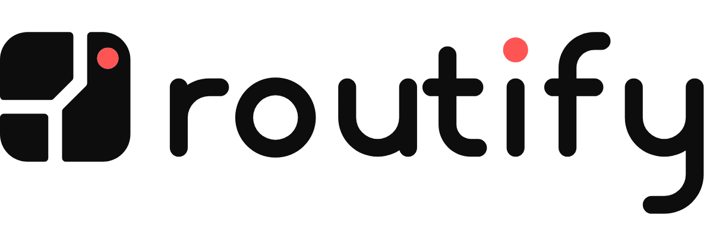

# Routify — logo guidelines



## 1. The logo

**Idea:** three city blocks. The streets between them are the route, and the red node is where it ends.

The mark updates the old outlined map tile. The blocks are solid now, so the streets survive at favicon size. The
wordmark is drawn by hand in round-capped lines, the same way the app draws roads. Because it is custom, it needs no
font licence. The dot on the "i" is the same red node.

| Version | Light backgrounds | Dark backgrounds |
|---|---|---|
| Horizontal (primary) | `logo/routify-horizontal.svg` | `logo/routify-horizontal-reversed.svg` |
| Stacked | `logo/routify-stacked.svg` | `logo/routify-stacked-reversed.svg` |
| Symbol | `logo/routify-symbol.svg` | `logo/routify-symbol-reversed.svg` |
| Symbol, 32 px and smaller | `logo/routify-symbol-small.svg` | `logo/routify-symbol-small-reversed.svg` |
| Wordmark only | `logo/routify-wordmark.svg` | `logo/routify-wordmark-reversed.svg` |
| One colour | `logo/*-black.svg` | `logo/*-white.svg` |

The reversed and white versions have slightly wider streets (24 instead of 22 units). This stops light-on-dark artwork
from looking heavier than the original. Use them on dark backgrounds instead of recolouring the light version.

All masters are generated by `source/build.py`. To change the geometry, edit that script and run
`python3 brand/source/build.py`. Don't edit the SVGs by hand.

## 2. Clear space

Let **x** be the diameter of the red node. Keep at least **2x** of empty space around the logo on every side. The
space scales with the logo.

## 3. Minimum size

| Version | Screen | Print |
|---|---|---|
| Horizontal | 120 px wide | 30 mm wide |
| Stacked | 64 px wide | 18 mm wide |
| Symbol | 16 px (use the `-small` cut at 32 px and below) | 6 mm |

## 4. Colour

| Name | Role | HEX | RGB | CMYK (approx.) |
|---|---|---|---|---|
| Ink | Mark on light, app background | `#0D0D0D` | 13 13 13 | 0 0 0 95 |
| Frontier | Mark on dark (the app's "search" glow) | `#E1FAF2` | 225 250 242 | 10 0 5 0 |
| Route | The node and the dot on the "i" (the app's path colour) | `#FF5454` | 255 84 84 | 0 80 62 0 |

The nearest Pantone match for Route is about **178 C**. Check it against a swatch book before any spot-colour print.
Frontier has no confirmed Pantone match yet.

Approved pairs:
- Ink + Route on white or light grey
- Frontier + Route on Ink or other near-black
- All black on light
- All white on dark or on photos (on a calm area)

The node stays red in the colour versions. In one-colour versions it becomes a hole.

## 5. Typography

- **Logo:** the custom wordmark. Don't type it out in a font.
- **Interface:** [Manrope](https://fonts.google.com/specimen/Manrope) (SIL Open Font License), as used in the app.

## 6. Don'ts

- Don't stretch, squash or rotate the logo.
- Don't recolour it outside the palette, or make the node any colour except Route red.
- Don't add shadows, outlines, gradients or glows. The app's bloom effect is for the map, not the logo.
- Don't rearrange or resize the parts of a lockup, or move the node.
- Don't place it on busy map imagery without a solid Ink container.

## 7. Files

```
brand/
  logo/            SVG masters (colour, reversed, black, white, small-size cut)
  exports/symbol/  PNG sizes, app icon, favicon.ico/svg, web icons, site.webmanifest, head snippet
  exports/lockups/ horizontal, stacked and wordmark PNGs
  presentation/    identity board (routify-identity.html) and slide PNGs
  concepts/        first-round concepts and iterations (archive)
  source/build.py  generator for every master
```

The web app uses `frontend/public/logo.svg`, `logo-dark.svg`, `favicon.svg`, `favicon.ico`, `apple-touch-icon.png`,
`icon-192.png`, `icon-512.png`, `maskable-512.png` and `site.webmanifest`. These are copies from this folder.

**Notes:**
- The adaptive `favicon.svg` switches to Frontier in dark mode. The raster `favicon.ico` stays in Ink.
- A trademark search has not been done. Run one before any wider launch.
